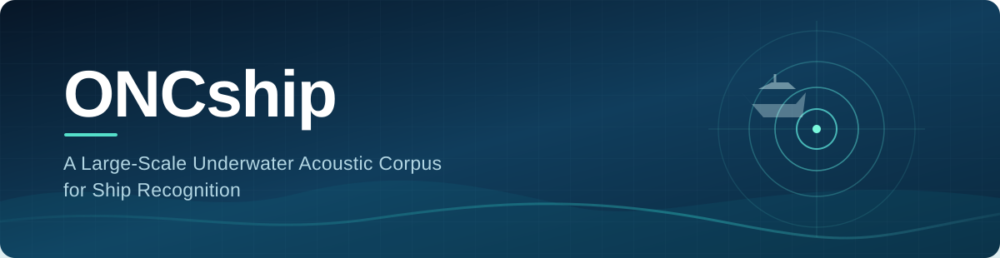
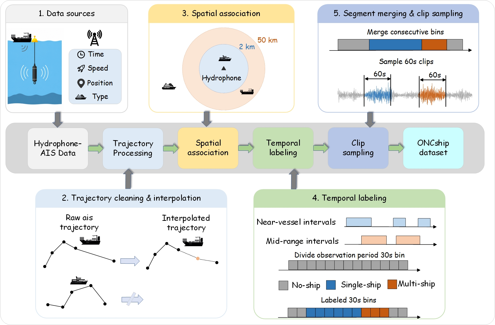

<!-- ONCship project landing page. Keep dataset access and license statements synchronized with the Hugging Face dataset card. -->

<p align="center">
  
</p>

<h1 align="center">ONCship</h1>

<p align="center">
  <strong>A Large-Scale Underwater Acoustic Corpus for Ship Recognition</strong>
</p>

<p align="center">
  A real-world hydrophone and AIS-based dataset for underwater acoustic representation learning,
  vessel-type classification, and individual-vessel identification.
</p>

<p align="center">
  <a href="https://arxiv.org/abs/2610.19722"></a>
  <a href="https://huggingface.co/datasets/zcao123/ONCship"></a>
  <a href="https://github.com/zcao-123/ONCship"></a>
</p>

<p align="center">
  <a href="#overview">Overview</a> ·
  <a href="#dataset-at-a-glance">Dataset</a> ·
  <a href="#supported-research-tasks">Tasks</a> ·
  <a href="#benchmark-highlights">Benchmarks</a> ·
  <a href="#access-the-dataset">Access</a> ·
  <a href="#citation">Citation</a>
</p>

---

## Overview

**ONCship** is a large-scale real-world underwater acoustic corpus constructed from hydrophone recordings provided by **Ocean Networks Canada (ONC)** and vessel information from the **Automatic Identification System (AIS)**. The dataset contains approximately **4,521 hours** of curated recordings from **six ONC hydrophone stations**, covering **single-ship**, **multi-ship**, and **no-ship** acoustic scenarios.

ONCship is designed to facilitate research in underwater acoustic representation learning and ship recognition, and its vessel-level metadata also enables the study of fine-grained **MMSI-level individual-vessel identification**.

## Dataset at a Glance

| Metric | ONCship |
| :--- | :--- |
| **Total duration** | **4,521 hours** |
| **Hydrophone stations** | **6** (Ocean Networks Canada) |
| **Data sources** | Underwater hydrophone recordings + AIS information |
| **Acoustic scenarios** | Single-ship · Multi-ship · No-ship |
| **Research tasks** | Self-supervised pre-training · Vessel-type classification · MMSI-level identification |
| **Dedicated individual-vessel benchmark** | 100 hours · 50 vessel identities |

## Dataset Construction

<p align="center">
  
</p>

ONCship brings together real-world underwater sound recordings and vessel context. The recording environments include single-vessel presence, overlapping vessel activity, and intervals without detected ship activity.

## Supported Research Tasks

| Task | Research question | Typical evaluation |
| :--- | :--- | :--- |
| **Self-supervised acoustic representation learning** | Can large-scale unlabeled underwater recordings improve transferable audio embeddings? | Linear probing and downstream fine-tuning |
| **Vessel-type classification** | Can acoustic models distinguish categories of vessels? | Classification accuracy on external benchmarks |
| **MMSI-level individual-vessel identification** | Can a model recognize a specific vessel rather than only its type? | Top-1 and Top-5 classification accuracy |

## Benchmark Highlights

The accompanying [paper](https://arxiv.org/abs/2610.19722) reports the following representative results.

## Access the Dataset

The central access point for ONCship is the Hugging Face dataset page:

**[🤗 Open ONCship on Hugging Face](https://huggingface.co/datasets/zcao123/ONCship)**

- Browse the dataset card for descriptions, metadata, and usage notes.
- Use **Files and versions** to check the exact files currently available.
- Review licensing, source-data attribution, and redistribution requirements before downloading or reusing content.

**Important:** Data distribution and permissions must be described according to the current Hugging Face release and the terms of the original ONC and AIS data sources. The presence of a dataset repository does not, by itself, establish permission to redistribute original recordings.

## Paper

**ONCship: A Large-Scale Underwater Acoustic Corpus for Ship Recognition**  
*Zhe Cao, Jichao Zhang, Xiao-Lei Zhang*  
[arXiv:2610.19722](https://arxiv.org/abs/2610.19722) · [PDF](https://arxiv.org/pdf/2610.19722)

## Citation

If you use ONCship in your research, please cite:

```bibtex
@article{cao2026oncship,
  title   = {ONCship: A Large-Scale Underwater Acoustic Corpus for Ship Recognition},
  author  = {Cao, Zhe and Zhang, Jichao and Zhang, Xiao-Lei},
  journal = {arXiv preprint arXiv:2610.19722},
  year    = {2026},
  doi     = {10.48550/arXiv.2610.19722},
  url     = {https://arxiv.org/abs/2610.19722}
}
